# Canon XL: back on the workbench
**English** | [Français](README.fr.md)\
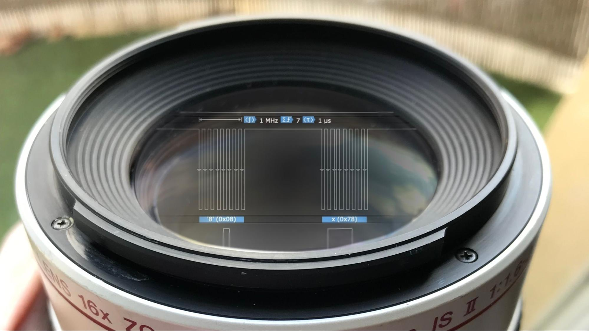\
A few years ago, I set out to make Canon XL video lenses work without their
original camcorder. These lenses still have plenty to offer: motorized zoom,
image stabilization and, on some models, fluorite elements. It seemed a shame
to leave them gathering dust alongside the camcorder.

The project was already well underway, but it also spent some time on a shelf.
Now I'm bringing it back to the workbench and revisiting the Arduino controller
I developed during those first experiments. This repository brings together
the revised code, the wiring, what I've learned about the protocol and the tests
that help keep the work moving.

## A Second Life in Astronomy

What interests me is giving retired equipment a new use for observing the sky.
Turning these lenses into "mini telescopes" provides a small demonstration and
imaging setup for experimenting with framing, focusing and image acquisition.

The first experiments had already produced images of the Moon. For now, I'm
concentrating on controlling the lens. Integrating the rest will come later.\
\
The imaging assembly: an XL 20x lens, a 1.6x extender and a ZWO ASI678MC camera,
joined by a 3D-printed adapter.\
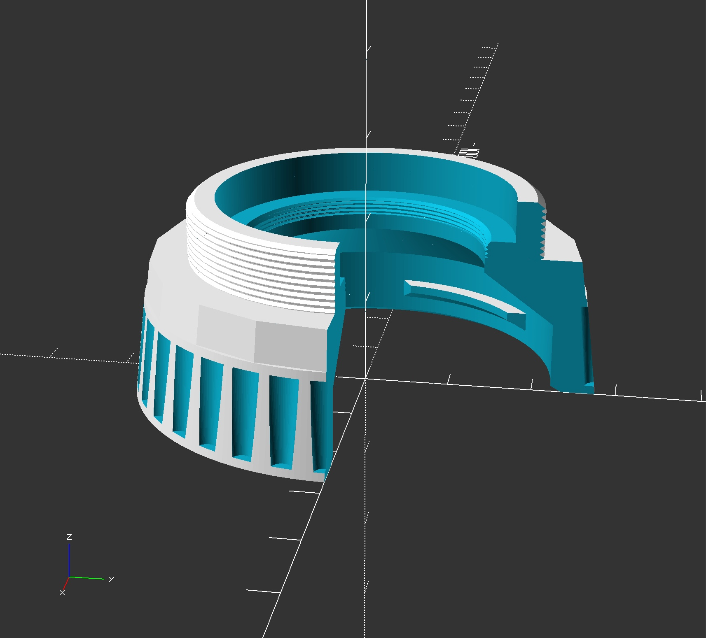\
A cutaway view of the adapter. Its STL file is available in the
[printable parts guide](hardware/README.md).\
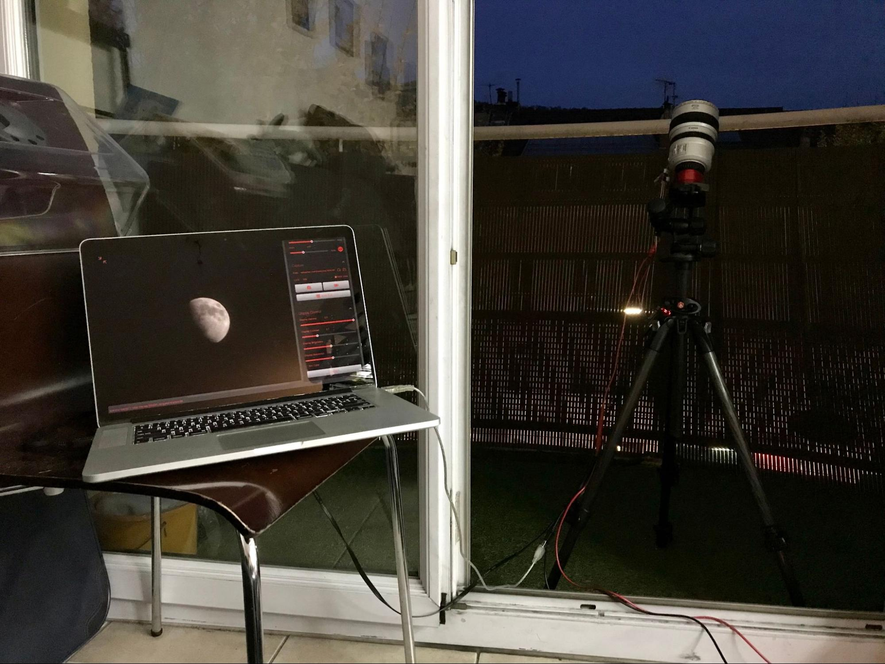\
The original setup, with the XL 20x and its 1.6x extender on a tripod.
The Moon is visible on the computer.\
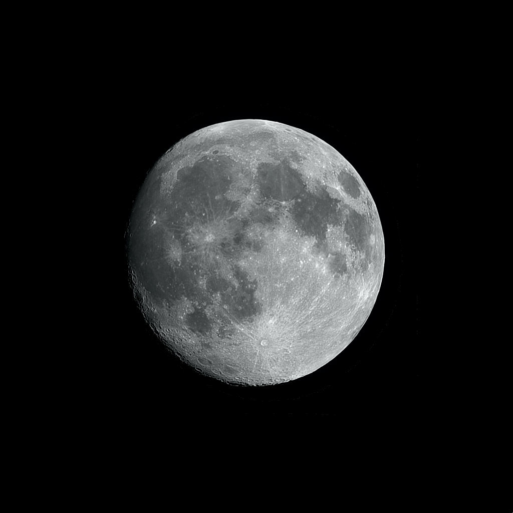\
An image of the Moon from those first experiments, taken with the XL 20x,
the 1.6x extender and a Baader Continuum 10 nm filter.

Eventually, I'd like to bring three projects together: this lens controller,
image acquisition with [EIP](https://eip.eliotis.com) and control of the telescope
mount. I'm also considering a Raspberry Pi with a Pi camera for imaging. Each project has its
own role; the next step is to make them work together for end-to-end control
of an observing session.

## Listening to the Lens

First, I needed to understand what the camcorder was telling its lens.
I soldered wires onto the mount contacts of a 16x lens to tap the SPI signals
and feed them into a logic analyzer. During these captures, the camcorder
remains the bus master: the analyzer only records the exchanges.\
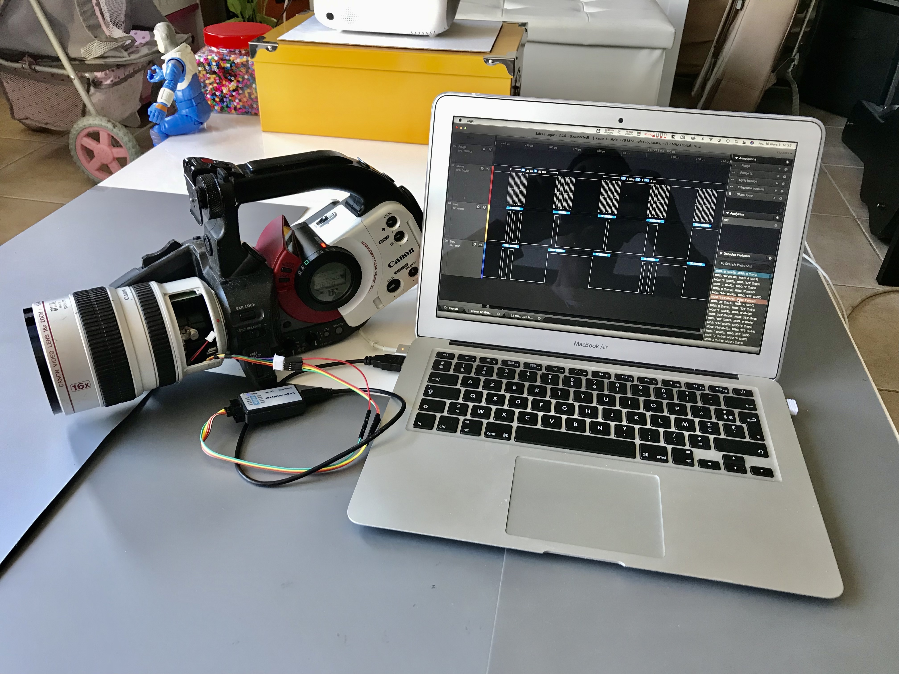\
The reverse-engineering bench: the 16x on its camcorder, the logic analyzer and
the laptop. The Arduino controller is then tested with the 20x.

The clock and select signal delimit the exchanges. MOSI carries data sent by
the camcorder; MISO carries the lens replies. The method is to change one control
at a time, then compare captures. This reveals which bytes change, separates
initialization from normal exchanges and gradually identifies commands and
feedback.

The captures studied show frames of **40 bytes in each direction**, with a
checksum. That's the basis of the Arduino controller: reproduce the dialogue
needed to operate the lens, then check what each command actually does on the
bench.

Some fields still need to be understood. Reading a value from a frame doesn't
make it a calibrated optical measurement.

## What Works Today

| Function | Status |
| --- | --- |
| Lens communication without a camcorder | ✓ Validated |
| Opening and closing the iris | ✓ Validated |
| Reading information returned by the lens | ✓ Validated for some controls |
| Manual zoom | ✓ Validated |
| Remote zoom control | ✓ Validated |
| X/Y control of the image stabilizer | ✓ Validated |
| Manual focus | ✓ Validated |
| Remote focus control | ☐ Not implemented yet |

These functions have been validated with the **Canon XL 20x and a classic
Arduino Nano**. Compatibility with other models still needs to be checked.

Two videos of the original prototype show the results:

- [Remote zoom control](https://www.youtube.com/watch?v=Sq8p5S8JtGc).
- [Image stabilizer control](https://www.youtube.com/watch?v=eJLDcAYVf6c).

## Hardware and Compatibility

| Hardware | Validation |
| --- | --- |
| XL 20x lens + classic ATmega328P Nano | Communication, iris, zoom and stabilizer X/Y control validated; some feedback fields identified. |
| XL 16x lens + Canon camcorder | Communication observed with a logic analyzer; operation with the current controller still needs validation. |
| Nano RP2040 Connect | Compilation and software tests completed; electrical validation and lens tests still needed. |

To reproduce the standalone bench, you'll need:

- A Canon XL lens and a classic Arduino Nano.
- A separate regulator to power the lens, sharing a common ground with the Nano.
- Connecting wires and a USB cable for the Nano.
- A computer with the Arduino IDE and a serial monitor.

A logic analyzer is useful for studying the protocol, but the controller works
without one. For imaging, the setup shown here uses a ZWO ASI678MC camera and a
3D-printed adapter.

## The Project in Pictures
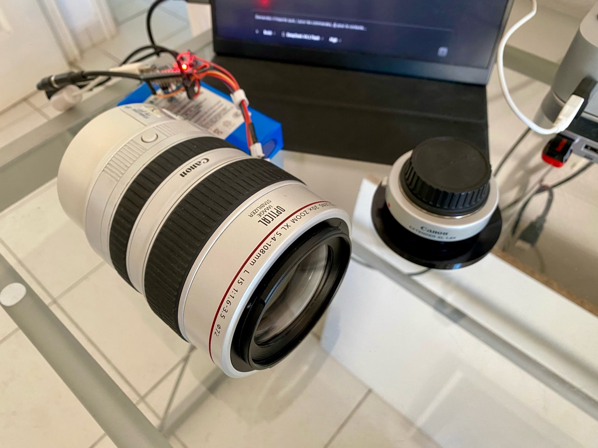\
The 20x fluorite lens on the bench, controlled by the Nano without its original camcorder.\
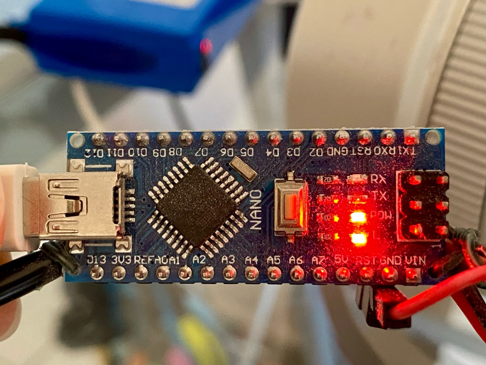\
The classic Nano used for the tests.

## The Wiring
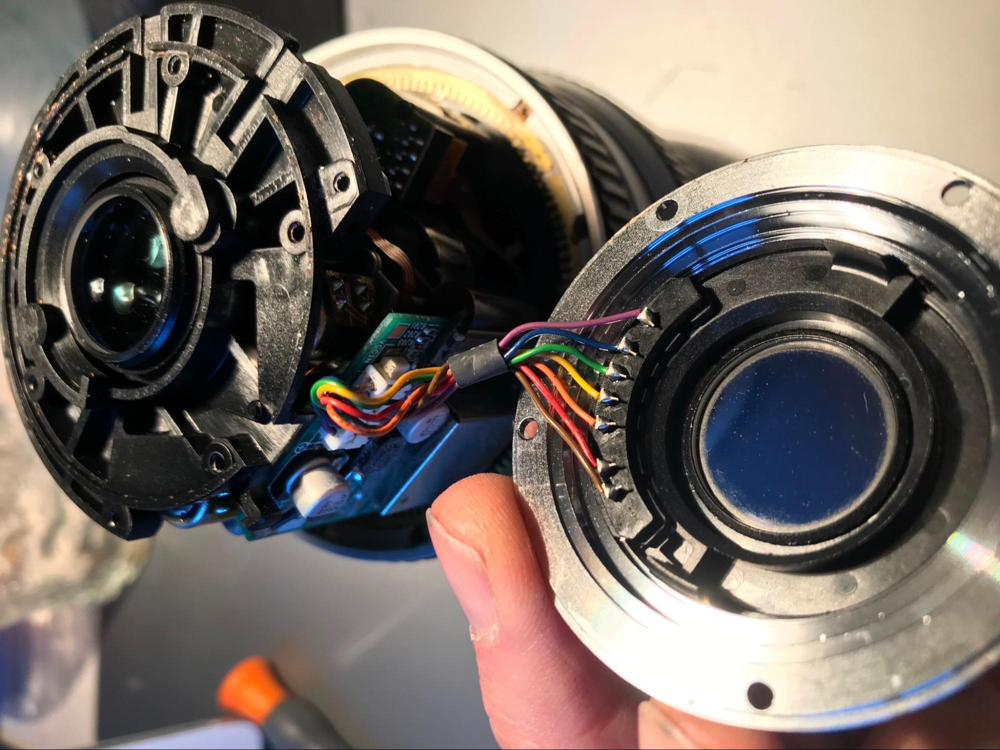\
The opened mount shows the wires soldered on the lens side. Their colors match
the diagram and table in the [wiring guide](doc/wiring.md).
These are the colors of my own setup.\
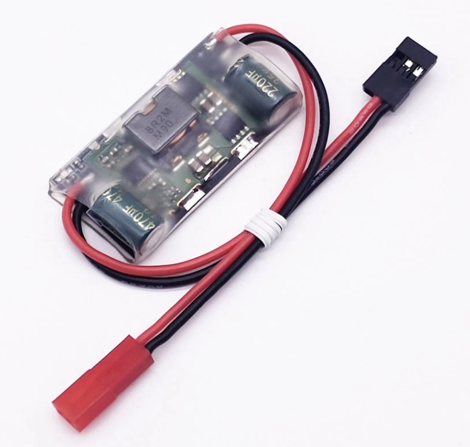\
The setup uses a **UBEC-3A-7.4 V** regulator supplied from **12 V**.
The Nano controls the lens, while the regulator supplies its power.
**Do not power the lens from a Nano output.** Check the regulator's output voltage
and polarity before connecting it.\
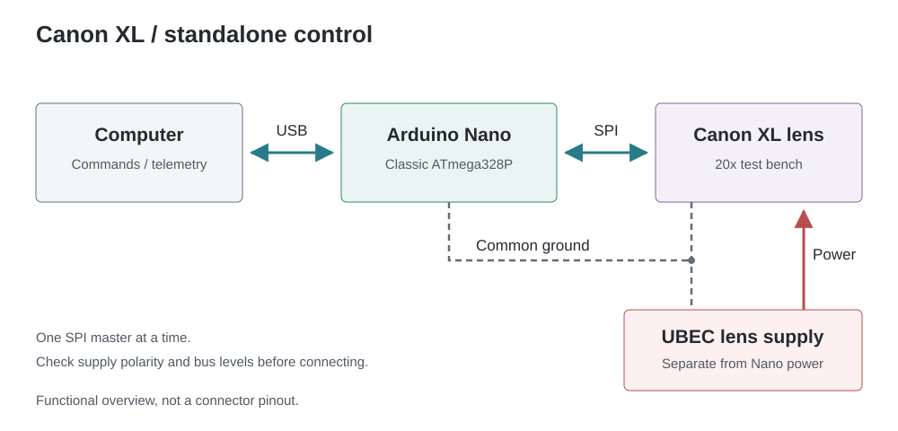\
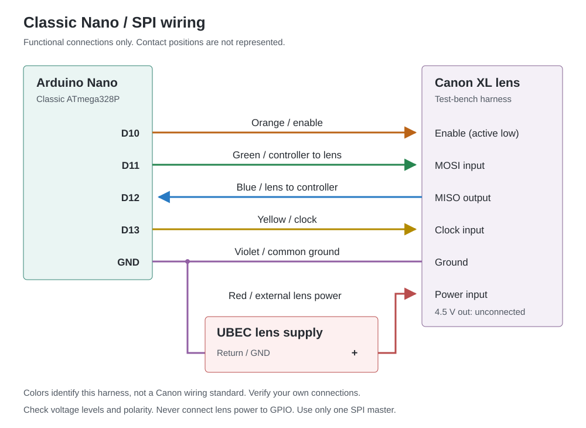\
The wiring diagram shows the functions of the harness, not the positions of the
mount contacts. The [wiring guide](doc/wiring.md) covers precautions and the
differences between supported boards.

## Printable Parts

Three models are available as STL files:

| Part | File |
| --- | --- |
| XL-to-ZWO ASI camera adapter | [canon-xl-to-zwo-asi-adapter.stl](hardware/stl/canon-xl-to-zwo-asi-adapter.stl) |
| Front lens cap | [canon-xl-front-lens-cap.stl](hardware/stl/canon-xl-front-lens-cap.stl) |
| Rear lens cap | [canon-xl-rear-lens-cap.stl](hardware/stl/canon-xl-rear-lens-cap.stl) |
### Preview
\
Dimensions and fitting precautions are in the [printable parts guide](hardware/README.md).

## Getting Started

Open [canon_xl_controller.ino](canon_xl_controller/canon_xl_controller.ino) in
the Arduino IDE. For the classic Nano used on the bench, select **Arduino Nano**,
then **ATmega328P (Old Bootloader)**. No external Arduino library is required.

Read the [wiring guide](doc/wiring.md) before connecting anything. The lens needs
its own power supply and a common ground with the controller. The classic Nano
and the RP2040 Connect use different logic levels: 5 V and 3.3 V. Before changing
boards, check the lens SPI voltages and adapt the levels if necessary.

Select the Nano's USB port, then compile and upload the sketch. If the board
already contains a program you want to keep, back it up before replacing it.

Then open a serial monitor at **115200 baud**, with LF or CRLF line endings.
Wait for the first telemetry lines, then send:

```text
STATUS
```

A response of the form `XL,1,...,ready,normal,...` (abbreviated here) indicates
that digital communication has been established. The `init` and `probe` states
are part of initialization. The [serial protocol](doc/serial-protocol.md)
describes the other fields and available commands.

Keep in mind that opening the port can reset the Nano, and the controller
requests a closed iris at startup.

## Working on the Code

The protocol, controller, serial command handling and telemetry are written
in C++11, independently of Arduino. Board-specific modules handle SPI;
the sketch coordinates communication and serial input/output.

Four test suites can run on your computer without a connected lens:

```sh
cmake -S . -B build/host -DXL_SANITIZERS=ON
cmake --build build/host
ctest --test-dir build/host --output-on-failure
```

The [development guide](doc/development.md) covers Arduino CLI builds, formatting
and documentation generation. The [coding convention](doc/coding-style.md)
sets out the project's code rules.

## The Control Panel

The interface built with [Processing](https://processing.org/) controls the
iris, zoom and X/Y stabilizer from the computer. It also displays information
returned by the lens and can record the exchanges. Remote focus control still
needs to be implemented.\
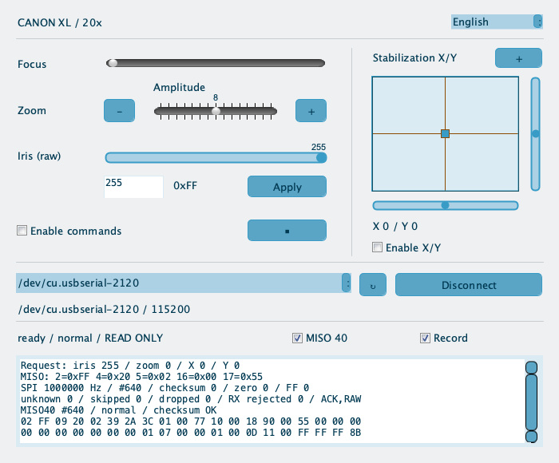\
In this capture, the panel is connected to the Nano in read-only mode and shows
real feedback from the 20x. Commands must be explicitly enabled before operating
the lens.

The [panel sources and launch guide](processing/README.md) are included in this
repository, along with a demonstration mode that works without a lens.

## What's Next

There's more information to identify in the lens replies, and more models to
compare. Remote focus control is also on the list, followed by integration
with image acquisition and the telescope mount.

## Why Share This Project?

I'd like these experiments to help anyone who still has an XL lens and wants
to give it a new use. That's why the code, wiring and observations are here.
With others joining in, we can compare results and understand the equipment
better.

Have an XL lens, measurements or experience with these optics? Feedback is
welcome, especially when comparing models. To make tests reproducible, please
include the lens model, board, wiring and firmware version used.

## Reverse Engineering and Independence

This project observes SPI exchanges between a Canon camcorder and its lens
during normal operation. The logic analyzer records the signals passively,
without sending commands onto the bus. These observations make it possible
to develop an independent controller and reuse the lens without its original
camcorder. This is distinct from firmware decompilation.

**French law recognizes this kind of study under certain conditions.**
[Article L151-3 of the Commercial Code](https://www.legifrance.gouv.fr/codes/article_lc/LEGIARTI000037266559)
recognizes observation, study, disassembly or testing of a publicly available
or lawfully possessed product as lawful ways to obtain a trade secret, subject
to applicable contractual restrictions.

For embedded software, **paragraph III of
[Article L122-6-1 of the Intellectual Property Code](https://www.legifrance.gouv.fr/codes/article_lc/LEGIARTI000044365559)**
allows a person entitled to use the software to observe, study or test its
operation during actions they are entitled to perform, to understand its ideas
and principles. Contractual clauses contrary to that provision are void.
Paragraph IV separately regulates code reproduction or translation
indispensable to interoperability.

This repository distributes neither Canon firmware nor copies of manufacturer
documentation. Publishing results remains subject to applicable rights and any
confidentiality obligations. The age of the equipment does not rule out
applicable patents. The [legal and licensing reference](doc/legal-and-licensing.md)
covers hardware and software observation, publication of results, trademarks,
patents and third-party components.

This project is neither affiliated with Canon nor endorsed by the company.
The Canon name is used only to identify the equipment concerned.

## Sharing Terms

CanonXL is distributed under the [CanonXL Noncommercial License, version 1.0](LICENSE).
You may use, modify and redistribute the sources for noncommercial personal,
educational and scientific projects. Institutional research and teaching are
permitted, including funded work, tuition and salaried staff, provided they are
not directed at developing a commercial product or service or performed as a
commercial research service.

When redistributing, retain the license and attribution, identify your changes
and provide the corresponding sources if you distribute compiled firmware.
Third-party components retain their own licenses.

**Commercial use requires prior written permission**, including sales of
products incorporating the code, paid services and commercial R&D.

Contact: [open an issue on GitHub](https://github.com/NoxSilicium/CanonXL/issues/new).

The [license guide](doc/licensing.md) explains the conditions for use,
modification and redistribution.

The English text of `LICENSE` is authoritative. This is a source-available
license, not GPLv3 or an open-source license in the strict sense.
