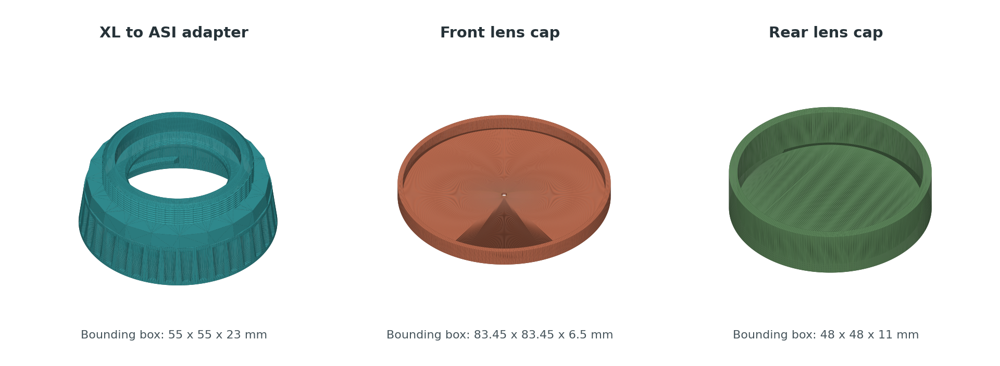
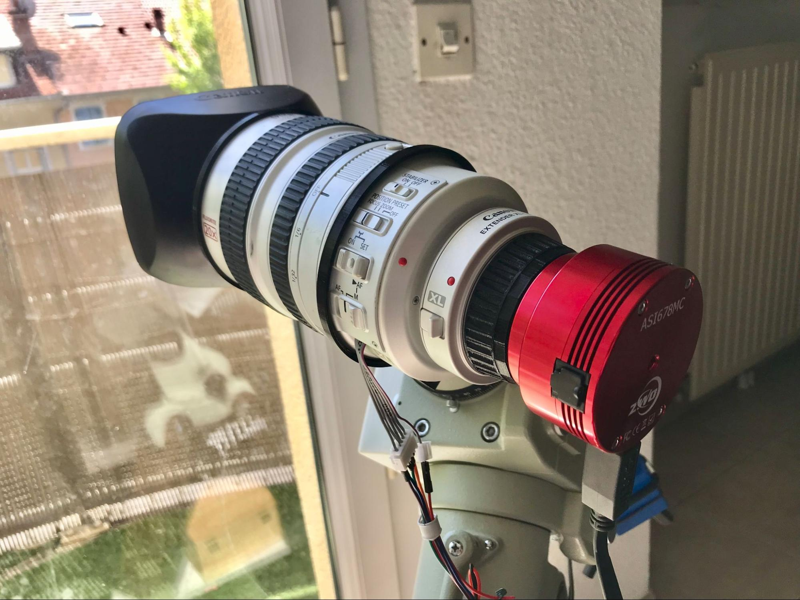

# Printable Parts

Three STL models accompany the Canon XL imaging setup: an XL-to-ASI camera
adapter and front/rear lens caps. Each file is a complete single-part mesh.\
\
Preview rendered from the supplied meshes. Each view uses its own scale; colors
identify the parts and do not specify a printing material.

## Files

| Model | Purpose | Bounding Box at Millimetre Scale | Triangles |
| --- | --- | --- | --- |
| [canon-xl-to-zwo-asi-adapter.stl](stl/canon-xl-to-zwo-asi-adapter.stl) | Mechanical adapter between the XL lens mount and a ZWO ASI camera. | 55 x 55 x 23 mm | 57,768 |
| [canon-xl-front-lens-cap.stl](stl/canon-xl-front-lens-cap.stl) | Front lens protection. | 83.45 x 83.45 x 6.5 mm | 4,320 |
| [canon-xl-rear-lens-cap.stl](stl/canon-xl-rear-lens-cap.stl) | Rear lens protection. | 48 x 48 x 11 mm | 2,876 |

The adapter belongs to the setup illustrated with an XL 20x, a 1.6x extender and
an ASI678MC. It is not a universal fit specification for every XL lens or ASI body.\
\
The printed adapter in the imaging assembly. The extender is separate hardware,
not included in the STL files.

## Before Printing

- Import at 1:1 and select millimetres in the slicer. STL does not encode units;
  check the bounding box above before slicing.
- Check clearances against the actual lens, extender and camera. Bounding boxes
  are overall mesh dimensions, not interface diameters or optical flange distances.
- Choose material, orientation, supports and layer settings for your printer.
  No validated slicer profile or strength/load rating is supplied.
- Check the printed part without forcing it onto the hardware. Remove loose
  debris and ensure that caps cannot contact exposed optics or electrical contacts.
- Verify focus travel, light-tightness and mechanical retention for the camera
  assembly. A closed mesh does not establish optical alignment or physical fit.

The files contain exported meshes, not editable OpenSCAD source. The telescope
support rings visible in other project photographs are separate parts and are
not included in these three files.

## Mesh Integrity

All three ASCII STL files were inspected with trimesh 4.9.0 after welding shared
vertices in memory. Each has one connected component, consistent winding, positive
volume and a closed surface. No non-finite coordinates, zero-area triangles,
boundary edges or non-manifold edges were found. The stored geometry was not
repaired, simplified, rescaled or re-exported.

These hashes identify the exact shared files:

| File | SHA-256 |
| --- | --- |
| `canon-xl-to-zwo-asi-adapter.stl` | `3189e7ae00b2820af3905963bc45ff6133d699ef9feb2fab4564057b8051affe` |
| `canon-xl-front-lens-cap.stl` | `d806726f3c5684fd83f735e73cdde05c2820b84a8c7953f54d7c307aa5fd2532` |
| `canon-xl-rear-lens-cap.stl` | `b62d1a35caee14e8b8c184ea9f85224529a6da770566fb0d299735c038021b79` |

## License

The models and their rendered preview are covered by the
[CanonXL Noncommercial License, version 1.0](../LICENSE).
Copyright (c) 2026 Sebastien Marchand (NoxSilicium).
